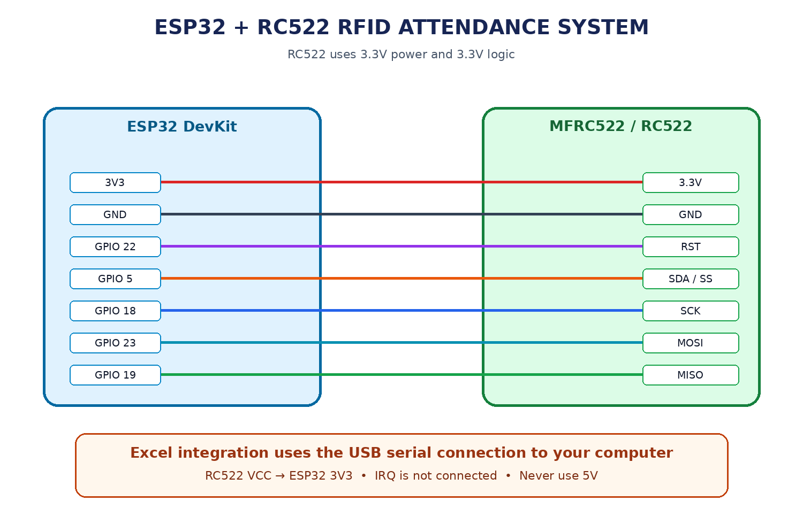

# RFID Smart Attendance System using ESP32

An automated smart attendance system that uses RFID technology and an ESP32 microcontroller to log attendance records directly into Microsoft Excel in real time. The system is built using an ESP32 DevKit, MFRC522 (RC522) 13.56 MHz RFID reader, and a lightweight Python serial logger for automated spreadsheet logging and duplicate scan prevention.

---

## Overview

This project implements an automated, contactless attendance recording system that identifies registered students via RFID cards and key fobs, synchronizing verified attendance records with an Excel workbook over serial communication.

### Key Features

- Contactless RFID-based student identification using MFRC522 (13.56 MHz)
- Real-time Excel logging via Python serial communication
- Dual-layer duplicate scan prevention (firmware debouncing and host-side date checking)
- Standalone RFID card UID scanner utility
- Formatted Excel workbook creation with styled headers, custom widths, and auto-filters
- Serial diagnostics and status reporting (Registered / Unknown card handling)
- Sub-second card detection and processing latency
- Clean separation between embedded firmware and desktop host software

---

## Demo

### Project Demonstration

See `media/` for demonstration assets and recordings of the system in operation.

When a registered card is brought near the MFRC522 reader, the ESP32 verifies the physical UID against registered student records, sends a structured serial payload (`EXCEL|UID|Name|PRESENT`), and the Python logger appends the entry to `attendance.xlsx` with accurate system timestamps and duplicate verification.

---

## Hardware Components

| Component | Description |
|-----------|-------------|
| ESP32 DevKit | Main microcontroller with VSPI and serial interface |
| MFRC522 RFID Reader | 13.56 MHz contactless card and tag reader |
| RFID Cards / Key Fobs | Contactless student identification credentials |
| USB Data Cable | ESP32 flashing and serial data transmission |
| Jumper Wires | SPI bus and power interconnects |

---

## Circuit Diagram



The system is built around an ESP32 DevKit connected to an MFRC522 RFID reader over the hardware VSPI bus (GPIO 18 SCK, GPIO 19 MISO, GPIO 23 MOSI, GPIO 5 SS/SDA, and GPIO 22 RST). Power is supplied through the ESP32 3.3V rail to protect the reader's 3.3V logic.

---

## System Architecture

```text
RFID Card / Key Fob
        │
        ▼
MFRC522 RFID Reader
        │
        ▼
   ESP32 DevKit
        │
        ▼
USB Serial Stream
        │
        ▼
Python Serial Logger
        │
        ▼
 attendance.xlsx
```

---

## Working Principle

The MFRC522 RFID reader communicates with the ESP32 over the SPI bus to read the unique identifier (UID) of passive RFID tags operating at 13.56 MHz.

When a card is detected, the system processes attendance through the following pipeline:

1. **UID Acquisition:** The ESP32 parses the card's serial number into a normalized, uppercase hexadecimal format.
2. **Registry Lookup:** The UID is compared against the internal student registry stored in memory.
3. **Session Debounce:** If the card was already marked during the current session, further transmission is suppressed to prevent rapid double-scanning.
4. **Serial Transmission:** A structured payload (`EXCEL|UID|Name|PRESENT`) is broadcast over USB serial at 115200 baud.
5. **Host Deduplication:** The Python logger checks `attendance.xlsx` to ensure the student has not already been logged for the current calendar date.
6. **Spreadsheet Persistence:** The verified record is appended to `attendance.xlsx` with formatted styling and timestamps.

---

## Project Structure

```text
rfid-smart-attendance-system/
│
├── docs/
│   ├── attendance-logic.md
│   ├── development-notes.md
│   ├── project-architecture.md
│   ├── setup-guide.md
│   └── troubleshooting.md
│
├── firmware/
│   ├── rfid_smart_attendance/
│   │   └── rfid_smart_attendance.ino
│   └── rfid_uid_scanner/
│       └── rfid_uid_scanner.ino
│
├── hardware/
│   ├── circuit-diagram.png
│   └── components.md
│
├── media/
│   └── README.md
│
├── attendance_to_excel.py
├── requirements.txt
├── README.md
├── LICENSE
└── .gitignore
```

---

## Results

- Reliable contactless student identification with low latency (< 500 ms)
- Fully automated Excel workbook updates without manual data entry
- Dual-layer protection against accidental or duplicate scans across reboots
- Clear diagnostic feedback in the terminal for rapid debugging
- Robust modular architecture separating embedded acquisition from desktop persistence

---

## Future Improvements

- On-device OLED / LCD display for instant visual confirmation
- Piezoelectric buzzer and indicator LEDs for auditory and visual feedback
- Real-Time Clock (RTC DS3231) for standalone offline timestamping
- Multi-classroom session and subject period tracking
- Cloud synchronization (Google Sheets, Firebase, or Supabase)
- Web-based attendance monitoring and analytics dashboard

---

## Documentation

Detailed project documentation is available in the `docs/` directory:

- Attendance Logic & Verification (`docs/attendance-logic.md`)
- System Architecture & Data Flow (`docs/project-architecture.md`)
- Hardware Setup & Configuration Guide (`docs/setup-guide.md`)
- Troubleshooting & Diagnostic Guide (`docs/troubleshooting.md`)
- Development Notes & Engineering Insights (`docs/development-notes.md`)

---

## License

This project is released under the MIT License.

---
